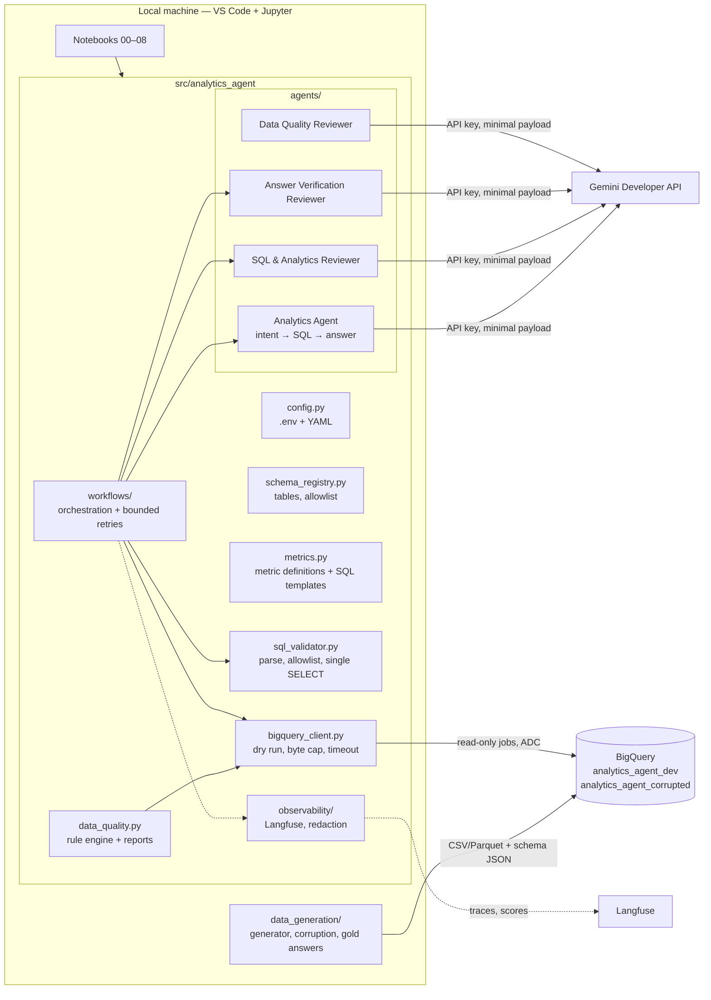
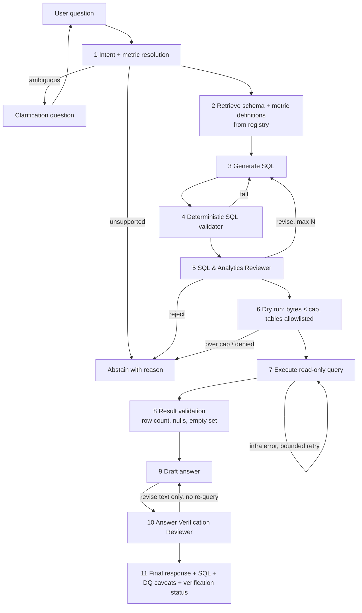
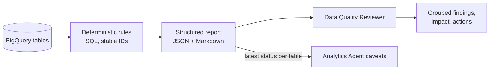

# 01 — Requirements and architecture

Status: **Stage 1 deliverable (for review).** Nothing in this document claims that BigQuery, Gemini or Langfuse have been connected; those integrations start in Stages 3, 4 and 7.

## 1. Goal

A local, reproducible prototype in which a business user asks an analytics question in natural language and receives an answer that is computed from real BigQuery data, produced by validated read-only SQL, checked by independent reviewers, and accompanied by its evidence (SQL, filters, values, data-quality caveats). A separate, independently runnable data-quality workflow detects and explains defects.

## 2. Requirements

### Functional

| ID | Requirement |
|---|---|
| F1 | Answer metric questions (trend, breakdown, ranking, rate, MoM change, reconciliation) using documented metric definitions. |
| F2 | Resolve relative periods ("last six months") against a configured `as_of` date and state the resolved range. |
| F3 | Ask for clarification instead of guessing when metric, period or scope is ambiguous and cannot be defaulted by a documented rule. |
| F4 | Support follow-up questions that refine the previous question (add a dimension, change the period). |
| F5 | Run deterministic data-quality rules independently of the analytics agent and produce human- and machine-readable reports. |
| F6 | Explain data-quality findings (grouping, impact, remediation) with an LLM reviewer that cannot override rule results. |
| F7 | Review generated SQL before execution and verify the final answer against the executed SQL and returned rows. |
| F8 | Abstain on unsupported questions (data not in the model, causal "why" questions without evidence). |

### Non-functional

| ID | Requirement |
|---|---|
| N1 | Runs from VS Code + local Jupyter; no Colab or Vertex AI dependency. |
| N2 | Gemini via the Gemini Developer API key (`GEMINI_API_KEY`); BigQuery via Application Default Credentials. Two separate auth paths. |
| N3 | Analytics runtime is read-only: dedicated principal, dataset allowlist, single `SELECT` statement, dry-run byte estimate, `maximum_bytes_billed`, timeout, row cap. |
| N4 | Deterministic checks are the source of truth; LLM output is never recorded as verified without evidence. |
| N5 | Minimal data to the model: schema and aggregated results only; no PII columns (`customers.email`) in prompts, logs or traces. |
| N6 | All retries bounded; expensive queries are not re-run on reviewer-only retries. |
| N7 | Reproducible data (fixed seed, manifest with hashes) and pinned dependencies. |
| N8 | Observability can be disabled for local tests. |

### Assumptions (documented, configurable)

1. Single currency (USD) and single country (US); multi-currency is out of scope for v1.
2. All timestamps are UTC; "month" means calendar month of the UTC date.
3. The data snapshot is taken at `as_of = 2026-07-03 00:00 UTC`; the order window is 2025-07-01 to 2026-06-30. Relative periods are resolved against the last complete month/quarter before `as_of`.
4. One shipment per order in v1, but SQL and metrics must not assume it (grain stays "shipment").
5. Item refunds cover merchandise only (no tax or shipping refunds) except cancellations, which refund the full captured amount at order level.
6. Your actual Google Cloud project and dataset IDs are placeholders (`<YOUR_PROJECT_ID>`, `analytics_agent_dev`, `analytics_agent_corrupted`).

## 3. Architecture

### Analytics workflow

### Data-quality workflow (independent)

## 4. Components

| # | Component | Inputs | Outputs | Responsibility / why it exists |
|---|---|---|---|---|
| 1 | BigQuery warehouse | CSV/Parquet loads with explicit schemas | Tables in two datasets | System of record; clean vs corrupted separated by dataset so permissions and allowlists can differ. |
| 2 | Local environment | `.env`, `configs/config.yaml` | Config object | One place for project/dataset IDs, model name, limits; secrets never in code. |
| 3 | Schema registry | — | Table/column metadata, allowlist, BigQuery JSON schemas | Single source of truth shared by loader, validator, prompts and docs. |
| 4 | Metric layer | Question intent | Reusable SQL templates + pandas reference | Keeps business logic out of prompts; gold answers come from here, not from an LLM. |
| 5 | SQL validator | SQL string | pass/fail + reasons | Deterministic safety: parse tree, single SELECT, allowlisted tables only, no DDL/DML/scripting. Not regex-only. |
| 6 | BigQuery client wrapper | Validated SQL, parameters | Rows, job ID, bytes | Dry run, `maximum_bytes_billed`, timeout, row cap, error classification. |
| 7 | Data-quality engine | Dataset ID | Rule results (pass/fail/warn/error) | Enforceable checks with evidence; the LLM only explains them. |
| 8 | Data Quality Reviewer | DQ report | Grouped findings, severity, actions | Interpretation for humans; cannot change statuses. |
| 9 | Analytics Agent | Question, context | Intent, SQL, draft answer | NL → metric → SQL. |
| 10 | SQL & Analytics Reviewer | SQL, intent, metric definitions | approve/revise/reject + findings | Catches grain, fan-out, wrong denominators and definition mismatches. Runs *after* the deterministic validator and cannot bypass it. |
| 11 | Answer Verification Reviewer | SQL, result rows, draft | approve/revise/abstain | Checks every number, period, unit and claim against returned rows. |
| 12 | Orchestration | All of the above | Final response, state | Explicit stages, bounded retries, human-review flag. Framework chosen in Stage 7. |
| 13 | Observability | Stage events | Langfuse traces, scores | Latency, tokens, reviewer decisions, BigQuery job IDs; redacted payloads. |
| 14 | Evaluation | Gold set, defect catalog | Metrics report | Measures correctness, safety, abstention, reviewer precision/recall. |

## 5. Security model (summary; detailed in Stage 3)

* Two principals: an **admin/loader** identity (dataset creation and loads) and a **read-only analytics** identity (`roles/bigquery.jobUser` on the project to run jobs, `roles/bigquery.dataViewer` on the approved dataset only).
* Defence in depth for SQL: parser-based validator → allowlist → dry run (also proves the principal can read only allowed tables) → byte cap → read-only IAM. An LLM reviewer adds judgement but is never a security control.
* User questions and database values are untrusted input. Retrieved rows are passed to the model as data inside delimited blocks, never as instructions.
* PII: `customers.email` is excluded from the agent's schema context and blocked by the validator for the analytics principal's queries.

## 6. Framework choice (Google ADK vs LangGraph)

Deferred to Stage 7, as the master prompt orders, and to be decided against the official documentation current at that time. The architecture above is deliberately framework-agnostic: every stage is a plain Python function with typed inputs and outputs, so the orchestrator is a thin layer. Evaluation criteria: Gemini Developer API (API-key) support, explicit conditional routing, bounded loops, structured outputs, state for follow-ups, human-in-the-loop interrupt, testability without network, and Langfuse integration.

## 7. Delivery plan

| Stage | Content | Status |
|---|---|---|
| 1 | Requirements, architecture, dataset design, metrics, evaluation plan | **delivered (this package)** |
| 2 | Generator, corruption, gold answers, tests, notebooks 01–02 | **delivered and executed locally in the build environment** |
| 3 | BigQuery upload (console + `bq`/Python), VS Code setup, ADC, least-privilege, cost controls, notebook 03 | next |
| 4 | Gemini API setup and smoke test | |
| 5 | Deterministic DQ engine: local backend **delivered** (50 rules, reports); BigQuery SQL backend with the same rule IDs | partly delivered |
| 6 | Reviewer agents and analytics agent: Data Quality Reviewer (Agent A) **delivered** with guardrails; SQL and Answer reviewers next | partly delivered |
| 7 | Orchestration framework + Langfuse | |
| 8 | Evaluation, integration tests, final demo | |
