# 02 — Dataset specification and business metric definitions

Companion files (generated, do not edit): [`data_dictionary.md`](data_dictionary.md) (every column, type, mode, allowed values), [`sample_records.md`](sample_records.md), [`03_defect_catalog.md`](03_defect_catalog.md), [`04_evaluation_plan.md`](04_evaluation_plan.md).

## 1. Schema decisions and changes from the proposed tables

The seven proposed tables are kept with their names. Additions and clarifications, with reasons:

| Change | Reason |
|---|---|
| `orders.order_date` (DATE) alongside `order_timestamp` | Partition column; makes "which month does this order belong to" unambiguous (UTC date). |
| Order-level money columns (`items_subtotal`, `discount_amount`, `shipping_amount`, `tax_amount`, `order_total`) | Shipping and tax exist only at order level; storing the header totals enables reconciliation checks against lines and payments. |
| Refund state is **not** an order status | A partially refunded order is still a delivered order. Putting "refunded" in `order_status` would lose the delivery fact and make partial refunds unrepresentable. Refund state lives only in `refunds`. |
| `payments.provider_transaction_id` | A business key distinct from the surrogate `payment_id`; duplicate-payment detection needs it. |
| `payments.failure_reason`, `orders.cancelled_timestamp` | Conditional columns that let checks distinguish legitimate failures/cancellations from broken records. |
| `refunds.order_item_id` nullable + `payment_id` | Item refunds attach to a line (product/category attribution); cancellation refunds are order-level. `payment_id` ties the refund to the money it returns. |
| `refunds.refund_status` | Only completed refunds affect net sales; pending ones are disclosed but excluded. |
| No `region` on orders | Region comes from the customer, so it has exactly one source. (Ship-to address is out of scope for v1.) |

## 2. Entity relationship diagram

```mermaid
erDiagram
    customers ||--o{ orders : places
    orders ||--|{ order_items : contains
    products ||--o{ order_items : "sold as"
    orders ||--o{ payments : "paid by (attempts)"
    orders ||--o| shipments : "shipped as (v1: 0..1)"
    orders ||--o{ refunds : "refunded by"
    order_items ||--o{ refunds : "item refund (nullable FK)"
    payments ||--o{ refunds : "refunded against"

    customers { STRING customer_id PK
                STRING email "PII, unique"
                STRING region
                STRING customer_segment
                DATE signup_date }
    products { STRING product_id PK
               STRING sku "unique"
               STRING category
               NUMERIC list_price }
    orders { STRING order_id PK
             STRING customer_id FK
             TIMESTAMP order_timestamp
             DATE order_date "partition"
             STRING order_status
             NUMERIC order_total }
    order_items { STRING order_item_id PK
                  STRING order_id FK
                  STRING product_id FK
                  INT64 quantity
                  NUMERIC net_amount }
    payments { STRING payment_id PK
               STRING order_id FK
               STRING provider_transaction_id "unique"
               STRING payment_status
               NUMERIC amount }
    shipments { STRING shipment_id PK
                STRING order_id FK
                STRING shipment_status
                DATE promised_delivery_date
                TIMESTAMP delivered_timestamp }
    refunds { STRING refund_id PK
              STRING order_id FK
              STRING order_item_id FK "nullable"
              STRING payment_id FK
              NUMERIC refund_amount
              STRING refund_status }
```



## 3. Identities and grain

| Identity | Table | Grain | Key | Notes |
|---|---|---|---|---|
| Customer | `customers` | one account | `customer_id` (`email` also unique) | |
| Product | `products` | one catalog item | `product_id` (`sku` also unique) | Prices constant in v1. |
| Order | `orders` | one checkout | `order_id` | Header: status and order-level money. |
| Order item | `order_items` | one product line within an order | `order_item_id`; (`order_id`, `line_number`) | A product appears once per order; quantity can be > 1. |
| Payment transaction | `payments` | one attempt | `payment_id`; `provider_transaction_id` | Orders may have failed attempts before a capture. |
| Shipment | `shipments` | one parcel | `shipment_id` | v1: 0 or 1 per order. |
| Refund transaction | `refunds` | one refund | `refund_id` | 0..n per order; item-level or order-level. |

## 4. Join rules and fan-out traps

Safe joins: child → parent (`order_items → orders`, `orders → customers`, `order_items → products`, `refunds → order_items`) never multiply the child's rows **if the parent key is unique**.

Fan-out joins (multiply rows):

| Join | Multiplies | Wrong result if you then… | Correct pattern |
|---|---|---|---|
| `orders ⋈ order_items` | each order × its lines (avg ≈ 2.2) | `SUM(order_total)`, `SUM(shipping_amount)`, `COUNT(*)` as orders | Sum item columns; count `DISTINCT order_id`; or aggregate items in a CTE first. |
| `orders ⋈ payments` | each order × attempts | sum order columns; sum `amount` without status filter | Filter `payment_status='captured'` and aggregate payments per order first. |
| `order_items ⋈ refunds` | each line × its refunds | sum `net_amount` | Aggregate refunds per line (or per dimension) separately, then combine. |
| `orders ⋈ order_items ⋈ payments` | lines × attempts | almost anything | Never join two child tables of the same parent directly; aggregate each to the parent grain first. |
| Any join to a parent with duplicate keys | silent duplication | everything | Data-quality rule `*_PK_UNIQUE` must pass first (the corrupted dataset's D01 demonstrates this). |

Orphans: an `INNER JOIN` to a parent silently drops orphan children (D05, D09). Analytics queries use inner joins to booked orders by design; data-quality checks report orphans separately so the drop is disclosed.

## 5. Volumes, period and planted patterns

| Table | Clean rows | Why this size |
|---|---|---|
| customers | 2,000 | Enough repeat buyers for segment/region analysis. |
| products | 250 | Enough per category for rankings; some products high volume, many long-tail. |
| orders | 15,000 | ~1,250/month over 12 months; ~2,000+ per region so monthly regional MoM is stable. |
| order_items | ≈32,800 | 1–6 lines per order (mean ≈ 2.2) — makes fan-out visible. |
| payments | ≈15,800 | Includes ≈1,250 failed attempts and pending payments. |
| shipments | ≈14,300 | Every shipped/delivered order. |
| refunds | ≈2,050 | ≈7% of delivered lines plus cancellation refunds. |

Total ≈ 9 MB per variant as CSV. BigQuery storage and on-demand query cost are negligible at this size (on-demand billing still applies a per-table minimum per query; Stage 3 explains dry runs and byte caps). Generation takes ~15 s on a laptop. `--scale` multiplies customers/products/orders; all logic is vectorised or linear, so 10× is practical.

Period: orders from **2025-07-01 to 2026-06-30**, snapshot **as_of 2026-07-03 00:00 UTC**. Orders in the last days before the snapshot are naturally `pending_payment`, `processing` or `shipped`; refunds requested in the final days are `pending`.

Planted patterns (so questions have meaningful answers): November–December seasonality; a Southwest demand drop in May and June 2026 (largest June MoM decline); carrier `metroexpress` is slower (higher late rate) than `swiftship`; eight products with a "bad batch" refund propensity; Apparel has the highest category refund propensity; late deliveries raise refund probability.

Partitioning and clustering: at this size neither materially changes cost, and BigQuery guidance favours not over-partitioning small tables. `orders` is partitioned by `order_date` purely to demonstrate partition pruning in dry-run byte estimates (Stage 3); other tables are clustered on their join/filter keys as listed in the data dictionary.

## 6. Business metric definitions

"Booked order" = `order_status IN ('processing','shipped','delivered')` — payment captured and not cancelled. All sales metrics use booked orders only. Dates are UTC; periods are inclusive; sales and their refunds are attributed to the **order date** (cohort basis — a refund in July for a June order reduces June net sales). The alternative refund-date basis is not used, and answers must not mix the two.

| Metric | Definition | Grain | Includes | Excludes |
|---|---|---|---|---|
| Gross item sales (GMV) | `SUM(order_items.gross_amount)` over booked orders | item | list price × qty | discounts, tax, shipping, cancelled/pending orders |
| Discounts | `SUM(order_items.discount_amount)` over booked orders | item | line discounts | — |
| Merchandise sales | `SUM(order_items.net_amount)` = GMV − discounts | item | | tax, shipping |
| Refund amount (sales-relevant) | `SUM(refund_amount)` where `refund_status='completed'` and `order_item_id IS NOT NULL`, joined to lines of booked orders | refund | partial refunds | pending refunds, cancellation refunds (their orders are not in sales) |
| **Net sales** | Merchandise sales − sales-relevant refunds | item | | tax, shipping, cancelled, pending-payment orders, pending refunds |
| Total payments received | `SUM(payments.amount)` where `payment_status='captured'` | payment | tax, shipping, payments on later-cancelled orders | failed, pending attempts |
| Net cash | Captured payments − all completed refunds (item + cancellation) | payment/refund | | pending refunds |
| Average order value | Merchandise sales ÷ `COUNT(DISTINCT order_id)` of booked orders | order | discounts applied | tax, shipping, refunds |
| Order refund rate | Booked orders with ≥ 1 completed item refund ÷ booked orders | order | | cancellation refunds |
| Product refund rate | Completed item refunds of the product ÷ its merchandise sales; only products with ≥ 30 units sold (threshold disclosed) | item | | |
| Late delivery rate | Delivered shipments with `DATE(delivered_timestamp) > promised_delivery_date` ÷ delivered shipments with a timestamp | shipment | | in-transit shipments |
| On-time delivery rate | 1 − late delivery rate (same denominator) | shipment | | |
| Cancellation rate | Cancelled orders ÷ all orders placed | order | all statuses in denominator | |
| Payment failure rate | Failed attempts ÷ all attempts, by payment date | payment | | |
| MoM % change | `(current − previous) / previous × 100`; NULL when previous is 0 or missing; compare **complete** months only, or disclose a partial month | period | | |

Treatment of special cases: **cancelled orders** contribute nothing to sales; if they were paid, the capture appears in payments and the full order-level refund in refunds. **Failed payments** never count; **pending payments** are disclosed but excluded from both sales and cash. **Partially refunded orders** remain booked; only the refunded amount is subtracted. **Taxes and shipping** are pass-through amounts excluded from sales but included in cash.

## 7. Reconciliation model

For orders placed in a period:

```
captured payments  = merchandise sales (booked) + shipping (booked) + tax (booked) + captured on cancelled orders
net sales          = merchandise sales (booked) − completed item refunds
net cash           = captured payments − completed item refunds − completed cancellation refunds
```

So payments exceed net sales by: shipping + tax + refunds already deducted from net sales + money captured on orders that were later cancelled. Pending payments and pending refunds are listed separately and excluded from both. A further *timing* difference appears when payments are grouped by payment date and sales by order date: an order placed at 23:58 on 31 January paid at 00:03 on 1 February lands in different months.

The identity is asserted by `tests/unit/test_metrics.py::test_full_reconciliation_bridge_is_zero` (difference = 0.00 on the clean dataset) and by a hand-computed tiny dataset test. Actual component values are in gold case **G07**.
